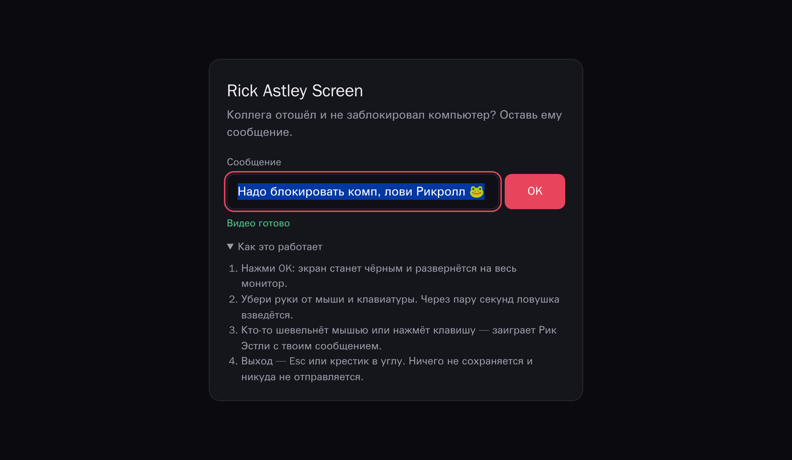

# Rick Astley Screen

Безобидный розыгрыш для коллег, которые отходят от компьютера и не блокируют его.
Открываешь страницу на их машине, пишешь сообщение, жмёшь OK. Экран гаснет
и ждёт. Стоит кому-то шевельнуть мышью или нажать клавишу, на весь экран
включается Rick Astley — _Never Gonna Give You Up_ — с твоим сообщением.

_A harmless prank for colleagues who leave their computer unlocked: type a message,
press OK, the screen goes black; the first mouse move or key press plays Rick Astley
with your message. English summary [below](#english)._



## Как это работает

1. Сообщение по умолчанию — «Надо блокировать комп, лови Рикролл 🐸». Свой текст можно ввести в поле или
   передать ссылкой: `https://…/#m=Обед%20за%20твой%20счёт`. Фрагмент `#…` не уходит
   на сервер и не попадает в логи.
2. **OK** (или Enter) разворачивает страницу на весь экран, делает его чёрным, прячет
   курсор и не даёт монитору уснуть (Screen Wake Lock).
3. Ловушка взводится, когда мышь и клавиатура пролежат в покое полторы секунды.
   Пока ты убираешь руку, ничего не сработает. Лёгкое дрожание мыши тоже не считается:
   нужно сдвинуть её хотя бы на 12 px за один раз.
4. Срабатывает на движение мыши, клик, колесо, касание, любую клавишу или выход из
   полноэкранного режима. Клип начинается с начала, сообщение появляется поверх, а снизу
   подсказка: «блокируй компьютер: Win + L» (на macOS свой шорткат).
5. Если браузер не дал включить звук без жеста (обычно Safari), видео идёт без звука
   и просит нажать любую клавишу.

Розыгрыш безобидный: страница ничего не хранит и никуда не отправляет. Выход —
обычный Esc или крестик в углу. Keyboard Lock и прочие способы «захватить» компьютер
не используются.

## Видео

**Клипа нет ни в репозитории, ни в образе: на него есть авторские права.** Скачайте его сами:

```sh
scripts/fetch-media.sh            # yt-dlp + ffmpeg → media/never-gonna-give-you-up.mp4 (720p, ~25 МБ)
```

Скрипт качает с YouTube и перекодирует для веба: H.264 + AAC, `+faststart`, чтобы
воспроизведение начиналось до конца загрузки. Без локальных yt-dlp и ffmpeg то же
самое делает контейнер `media` из [deploy/docker/compose.yaml](deploy/docker/compose.yaml).
Подойдёт и любой загрузчик на базе yt-dlp, например
[streaming-video-downloader](https://github.com/StApZzZ/streaming-video-downloader).

Страница заранее скачивает клип в память, поэтому в момент срабатывания он не
буферизуется. Видео можно отдавать с того же сайта (`media/`) или с CDN
(`RICKROLL_MEDIA_URL`; CDN должен отдавать CORS-заголовок `Access-Control-Allow-Origin`).

## Развёртывание

### Docker

```sh
docker compose -f deploy/docker/compose.yaml up -d     # http://localhost:8080
```

Или одним контейнером, если клип уже есть:

```sh
docker run -d -p 8080:8080 --read-only --tmpfs /tmp --cap-drop ALL \
  -v "$PWD/media:/usr/share/angie/html/media:ro" ghcr.io/stapzzz/rick-astley-screen:1
```

### Kubernetes

Kustomize: [deploy/k8s/base](deploy/k8s/base) — Deployment (non-root, read-only FS,
seccomp, без service account token), Service, PDB, NetworkPolicy без egress.
Пример оверлея с Ingress и CDN: [deploy/k8s/overlays/example](deploy/k8s/overlays/example).

```sh
kubectl apply -k deploy/k8s/overlays/example
```

### Страница существующего сайта

Под путём вроде `https://intranet.example.com/rick/`: прокси на контейнер или просто
копия статических файлов. Сниппеты для Angie (подходят и для nginx) и Traefik лежат в [deploy/proxy](deploy/proxy/README.md).
Сборка использует только относительные пути, поэтому работает под любым префиксом.

### Настройки контейнера

| Переменная                   | По умолчанию                             |                                                                              |
| ---------------------------- | ---------------------------------------- | ---------------------------------------------------------------------------- |
| `RICKROLL_DEFAULT_MESSAGE`   | `Надо блокировать комп, лови Рикролл 🐸` | сообщение, если просто нажать OK                                             |
| `RICKROLL_MEDIA_URL`         | `media/never-gonna-give-you-up.mp4`      | путь относительно страницы или `https://` URL (его origin сам попадёт в CSP) |
| `RICKROLL_MEDIA_TYPE`        | `video/mp4`                              | MIME-тип клипа                                                               |
| `RICKROLL_MEDIA_ORIGINS`     | —                                        | дополнительные origin'ы для CSP `media-src` / `connect-src`                  |
| `RICKROLL_ARM_DELAY_MS`      | `1500`                                   | сколько ждать покоя перед взводом                                            |
| `RICKROLL_MOVE_THRESHOLD_PX` | `12`                                     | на сколько надо сдвинуть мышь                                                |
| `RICKROLL_LOOP`              | `true`                                   | крутить клип по кругу                                                        |
| `RICKROLL_LOCK_HINT`         | `true`                                   | подсказка «блокируй компьютер»                                               |
| `RICKROLL_PREFETCH`          | `true`                                   | качать клип в память заранее                                                 |
| `RICKROLL_BASE_PATH`         | `/`                                      | префикс, если прокси его не срезает (`/rick/`)                               |

Неверное значение останавливает контейнер с понятной ошибкой: лучше упавший rollout,
чем страница, у которой CSP молча блокирует видео.

## Безопасность

Каждый пуш в `main` проходит одни и те же ворота, и только после них образ
подписывается и получает теги `main` / `latest`:

| Этап   | Что проверяет                                                                                                                                                                    |
| ------ | -------------------------------------------------------------------------------------------------------------------------------------------------------------------------------- |
| CI     | TypeScript (strict), ESLint (strict type-checked + no-unsanitized), Prettier, Vitest, shellcheck, `npm audit signatures`                                                         |
| E2E    | Playwright (Chromium, Firefox) против собранного контейнера: сценарии, XSS через сообщение, отсутствие нарушений CSP                                                             |
| SAST   | CodeQL (TypeScript, Actions), Semgrep, Gitleaks по всей истории, Trivy (зависимости, IaC, секреты), OSV-Scanner, Hadolint, actionlint, zizmor, npm audit, Dependency Review в PR |
| Образ  | Trivy по опубликованному дайджесту (HIGH/CRITICAL с исправлением блокируют)                                                                                                      |
| DAST   | smoke-тест заголовков и OWASP ZAP baseline + full scan (активные атаки) против того же дайджеста                                                                                 |
| Выпуск | cosign keyless-подпись, SLSA provenance, SBOM, мультиархитектура amd64/arm64                                                                                                     |

Страница отдаётся со строгим CSP (`default-src 'none'`, без inline-скриптов, Trusted
Types), COOP/COEP/CORP, `nosniff`, `frame-ancestors 'none'`. Все actions закреплены по SHA,
образы — по дайджесту; обновления предлагает Dependabot с недельной выдержкой.
Проверка подписи и как сообщить об уязвимости: [SECURITY.md](SECURITY.md).

## Разработка

Node.js 24 LTS.

```sh
npm ci
npm run dev            # http://localhost:5173 (положите клип в public/media/ или media/)
npm run check          # typecheck + lint + format + unit
npm run test:e2e       # Playwright (сам соберёт и поднимет vite preview)
```

Стек: TypeScript 7 (нативный компилятор; TypeScript 6 оставлен только как API для
typescript-eslint), Vite 8, Vitest 5, Playwright, ESLint 10, Angie 1.12 (minimal, без root).
Фреймворков и рантайм-зависимостей нет: в браузер уходит меньше 10 КБ (gzip).

## English

A static page (TypeScript, no runtime dependencies) served by Angie as an unprivileged user.
Type a message (default: «Надо блокировать комп, лови Рикролл 🐸», "you should have locked the PC, enjoy the Rickroll"), press OK:
the page goes fullscreen and black, keeps the display awake and arms itself once the
mouse has been still for 1.5 s. The next mouse move, click, wheel, touch or key press
plays the video with the message on top and a "lock your computer" hint.

The clip is **not** included (copyright): `scripts/fetch-media.sh` downloads and
transcodes it. Run with Docker Compose, Kubernetes (kustomize) or as a sub-path of an
existing site (reverse proxy or static copy); all settings are environment variables
(table above). Images are built once, scanned (Trivy, OWASP ZAP baseline and full scan
against the pushed digest), then signed (cosign keyless) with SLSA provenance. See
[SECURITY.md](SECURITY.md).

License: [MIT](LICENSE). Rick Astley and the song belong to their owners; this project
only plays a file you provide.
